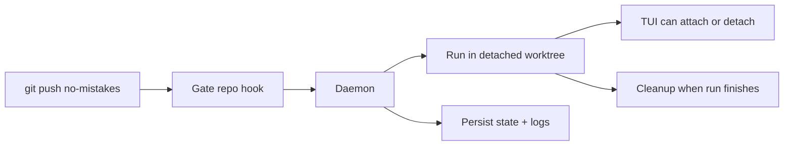

The daemon is a long-running background process that manages pipeline runs. The
installer prefers setting it up as a managed background service, and
`no-mistakes`, `init`, `attach`, `rerun`, and `update` keep that service
installed and running for you when that path is available.

## Why a daemon exists

The daemon exists so `git push no-mistakes` stays fast and the gate can keep
working after your shell command returns.

- Git hands the push to the local gate repo.
- The hook notifies the daemon and exits immediately.
- The daemon owns the long-running work: worktrees, pipeline execution, TUI
  events, state, cleanup, and crash recovery.



On macOS this is a per-user `launchd` agent, on Linux a per-user `systemd` service, and on Windows a Task Scheduler task. The installed artifact names are scoped by `NM_HOME` with a short stable suffix, so the paths and service identifiers look like `~/Library/LaunchAgents/com.kunchenguid.no-mistakes.daemon.<suffix>.plist`, `~/.config/systemd/user/no-mistakes-daemon-<suffix>.service`, and the Windows task `no-mistakes-daemon-<suffix>`. That keeps multiple `no-mistakes` installs from colliding when they use different `NM_HOME` roots. Those service managers keep the daemon available across CLI invocations and restart it after `no-mistakes update` replaces the binary. A managed service starts with a minimal environment, so at daemon startup it resolves `PATH` and proxy variables from your login shell and the baked-in service definition; [Environment the daemon sees](/no-mistakes/reference/environment/#environment-the-daemon-sees) owns that resolution story. Restart the daemon after changing those values. If managed service install or startup is unavailable or fails, `no-mistakes` falls back to starting a detached daemon process instead.

On Windows the daemon runs without a console window. The Task Scheduler task starts `no-mistakes.exe daemon run` directly at logon, and `no-mistakes.exe` carries an application manifest that tells Windows not to create a console for it when there is none to share, while a terminal, git hook, or agent that runs `no-mistakes` still shares its console with it. Windows honors that setting from Windows 11 24H2 and Windows Server 2025 (build 26100). Older builds still create a console when the task starts, which the daemon releases as soon as it starts, so a console or Windows Terminal window can flash briefly at logon. Output the daemon writes before its logs are ready goes to the bootstrap log described under [Logging](#logging).

The Windows task runs the daemon at Task Scheduler priority 4, so the daemon and every git, agent and test command it starts run with normal processor, disk and memory priority, like a command run from a terminal.
Task Scheduler's default of 7 would start all of them below normal on the processor with low disk and memory priority, which starves the gate on a busy host.
Every start of a stopped daemon, from `daemon start`, `daemon restart`, `no-mistakes update` or a command that starts a missing daemon on demand, registers the task again, so a task registered at another priority is corrected then.
A daemon that is already running keeps the priority it was started with, and so does the version a `--when-idle` restart starts, so run `no-mistakes daemon restart` to move a running daemon to the new priority.
The daemon sets no processor affinity, so on a host with efficiency cores Windows places its commands the way it places a terminal's.
A mask that kept them off efficiency cores would be specific to each host, would be inherited by every command, and would leave those cores unused even when the performance cores are saturated.

## Starting and stopping

Most people do not need to manage the daemon directly. The usual commands
already make sure it exists when needed.

```sh
# Explicit management
no-mistakes daemon start
no-mistakes daemon stop
no-mistakes daemon uninstall
no-mistakes daemon restart
no-mistakes daemon restart --when-idle
no-mistakes daemon status

# Ensures the daemon is running, using the managed service when possible
no-mistakes
no-mistakes init
no-mistakes attach
no-mistakes rerun
no-mistakes axi run
no-mistakes axi respond
no-mistakes axi handoff

# Resets the daemon after replacing the binary
no-mistakes update
```

`no-mistakes update` stops and starts the daemon when it is running, or when stale daemon artifacts exist, so the new executable is used. On macOS and Linux the start runs the newly installed binary's `daemon start`, so the LaunchAgent or systemd unit is rewritten from the new version's service definition.
It prefers the managed service path and falls back to a detached daemon if service startup is unavailable or fails.
If pending or running pipeline runs exist, `update` refuses to restart the daemon by default and prints each active run's ID, status, branch, and short head SHA. Pass `--force` to restart the daemon anyway and accept that those runs may fail; `-y`/`--yes` does not bypass this guard.

Pass `--when-idle` to let active runs finish: when the running daemon supports scheduling, `update` installs the new binary and then schedules a restart when idle, printing any active runs as runs that finish on the current version.
It schedules the restart even when no run is active, so a run that starts during the download is not stopped either.
When the running daemon is too old to restart when idle, `update --when-idle` with active runs refuses and replaces nothing.
With no daemon process running, or an older daemon and no active run, it attempts the immediate reset under the same ordinary shutdown preparation as a plain update.
If that older daemon also lacks `prepare_shutdown`, the update refuses before binary replacement even with no active run.
A daemon process that is running but not accepting connections is refused rather than reset, as is any other failed status probe; retry, or use explicit `--force` subject to the force and bootstrap limits below.
`--force` takes precedence over `--when-idle`.
If the restart cannot be scheduled after the binary was replaced, `update` reports the installed version and the failure; run `no-mistakes daemon restart --when-idle` to finish.

`no-mistakes daemon restart --when-idle` schedules the same restart without an update. Once scheduled, the running daemon:

1. Lets every run that is executing a step, or queued for a slot, finish on the version it started on.
2. Holds a plain gate push that arrives meanwhile in `~/.no-mistakes/held-pushes.jsonl` instead of starting a run, and refuses `rerun`, retries, fresh launches, `axi validate-authored`, `axi sync --recover --continue`, and pushes from `axi run` with "the daemon is restarting for an update; try again shortly".
3. Does not wait for runs parked at an approval gate: a clean stop keeps them (see [Crash recovery](#crash-recovery)), so they resume on the new version.
4. Once no run is executing, stops cleanly and restarts from the executable file. On macOS and Linux it replaces its own process, keeping its PID, so the managed service or detached launch keeps owning it. Windows cannot replace a running process, so there the stopping daemon starts the new version as a detached daemon, waits until it answers, and exits; the PID changes, and a daemon first started by the scheduled task runs detached until its next `daemon start`.
5. Starts each held push as a new run as soon as the restarted daemon is ready, in the order they arrived, then removes the file. A push that arrives while held pushes are still being started is held behind them, so an older held push never replaces the run of a newer one. If another restart is scheduled mid-replay, the pushes not yet started stay in a `.replay` file beside the held file, and the next daemon starts them before any push held since.

An approval gate that would resolve or resume on its own while the restart is being marked due stays parked instead, and resumes on the restarted daemon. `daemon status` and `doctor` show a pending restart with the number of runs it waits for and pushes it holds. The git hook still prints its usual banner for a held push; the run appears after the restart. A restart when idle does not rewrite the managed service definition; run `no-mistakes daemon start` afterwards to refresh it. `--force` on `daemon restart` takes precedence over `--when-idle`. Without a running daemon, `--when-idle` starts one as a plain restart does.
If the daemon is already running from a different executable path, update still prompts before replacing it; `-y`/`--yes` answers that prompt non-interactively.
With `--when-idle` and active runs, that case is refused instead, because the daemon restarts through its own executable and would miss the update; run `update` with the binary that started the daemon, or pass `--force` subject to the limits below.
With no active run, `--when-idle` falls back to the plain prompt and attempts an ordinary guarded reset; accepting the prompt does not bypass shutdown acknowledgement.
If the daemon executable path cannot be determined, the update aborts before replacing anything.

`no-mistakes daemon stop` and `no-mistakes daemon restart` apply the same guard: if pending or running pipeline runs exist, each refuses by default and lists the active runs, and each takes its own `--force` to proceed anyway.
`no-mistakes daemon uninstall` applies this guard when a macOS LaunchAgent is installed.
A missing LaunchAgent, or a platform without service removal, is a no-op that does not invoke shutdown preparation or close admission.
The daemon makes the final idle check and closes admission together, including launches still preparing their run row, queued runs, and parked or recovered active runs.
If admission wins, ordinary maintenance refuses without changing that run.
If shutdown wins, later launches, source claims, hook admission, and gate responses refuse before changing run state.
Before closing admission, maintenance takes an exclusive OS lock on `daemon-lifecycle.lock` in the same `NM_HOME` as the socket, PID file and singleton lock.
Every daemon startup entrypoint takes shared access before touching startup resources; a startup parent and its child can hold shared access together without deadlocking on readiness.
The daemon releases its startup access once it owns the singleton, so an idle live daemon can still be stopped normally.
Maintenance retains exclusive access through binary replacement, service stop, process exit and artifact cleanup; the old daemon exiting cannot admit a replacement in that interval.
A conflicting or unreadable lock refuses immediately without retrying or changing admission, and the OS releases ownership if its holder crashes.
Before stopping a managed service or using a PID fallback, ordinary maintenance also requires the daemon's `prepare_shutdown` acknowledgement; a busy, unreadable, or unsupported response aborts the operation and releases maintenance ownership.
The acknowledgement leaves the daemon alive with admission closed so the caller can stop its managed service before keep-alive restarts it.
If no daemon is running, ordinary maintenance also holds the existing singleton lock through teardown.
Explicit force skips the idle acknowledgement and retains lifecycle maintenance exclusion and recursive containment; it does not acquire the absent-daemon singleton lock.
Restart operations release maintenance ownership only after teardown, before starting the intended replacement.
A prepared service start uses non-destructive start operations rather than stopping a replacement that may already have started; any failed-start rollback must establish maintenance ownership and idle admission again before restoring shared service resources.
After ordinary preparation closes admission, a later file replacement or service failure leaves it closed until the daemon is stopped and restarted; the command reports its failure.
An older running daemon cannot gain this boundary from a newly compiled client or binary replacement: a client that cannot obtain the acknowledgement refuses ordinary maintenance.
Safe bootstrap from such a daemon requires independently established exclusion of every launch, resume, and hook producer before an operator-authorized stop; an idle database snapshot or singleton lock alone does not establish that exclusion.
Concurrent lifecycle operations that cannot acquire the lock refuse; this boundary does not prevent an external service manager or operating-system signal from stopping the daemon, or coordinate startup binaries that predate the lock.
`no-mistakes daemon start` applies the same guard when it would restart a running daemon to refresh a changed service definition or replace an older daemon that does not support the gate-context RPC.
A refusal leaves the daemon running and the service definition unchanged; `--force` has the same limits as for the other lifecycle commands.
When a running daemon does not support that RPC, `daemon start`, `daemon stop`, `daemon restart`, `daemon uninstall`, and `update` check gate execution context locally, including process ancestry, and still refuse callers inside validation steps.
That local check does not supply a `prepare_shutdown` acknowledgement: ordinary `daemon start` and `daemon restart` refuse an older daemon that cannot confirm admission closure.
Replacing such a daemon requires the independently established bootstrap exclusion described above, not merely a new client or an idle database snapshot.
Ordinary startup refuses an unreadable process listing or a live, unresponsive owner under another spelling of the same root instead of killing it.
For a proven absent owner, startup retains lifecycle and singleton ownership through stale-artifact cleanup and service installation, then releases them before the non-destructive replacement start.
Cleanup after a failed managed start must establish ordinary shutdown preparation before stopping the service or attempting a detached fallback.
That `--force` override is available only to an ordinary top-level caller. A
process descended from an active validation-step agent cannot start, stop,
restart, uninstall, or update the daemon; recursive containment refuses the command before
any lifecycle mutation, with no `--force` or `--yes` bypass.
Every invocation of `daemon stop`, `daemon uninstall`, `daemon restart`, or `update`, and every `daemon start` that would restart a running daemon - forced or not - logs the caller's PID, parent PID, and parent command line to `~/.no-mistakes/logs/cli.log` so a later incident can identify which agent or process triggered it.

The daemon writes an identity record to `~/.no-mistakes/daemon.pid` and listens on a Unix socket at `~/.no-mistakes/socket`. On Windows, it uses a localhost TCP listener and a protected endpoint file at the same path. CLI clients bound how long they wait for that socket to accept a connection, and for the daemon to answer its health check, with `daemon_connect_timeout` (default `3s`, override with `NM_DAEMON_CONNECT_TIMEOUT`), so a daemon process that is alive but stuck fails the connection instead of hanging the caller, while a busy daemon that answers within the budget is still treated as running; see [Troubleshooting](/no-mistakes/guides/troubleshooting/#check-for-stale-artifacts).
On Windows, clients check the endpoint file's recorded PID before connecting.
An exited process is recognized even while its process object remains openable; invalid or nonexistent Windows PIDs are also classified as dead.
The resulting `daemon process <pid> is no longer running` error lets commands that ensure the daemon is running (`no-mistakes`, `init`, `attach`, `rerun`, `axi run`, `axi respond`, `axi handoff`) start a replacement.
Access failures and wait failures leave ownership unknown and continue to the normal connection attempt; a failed probe never proves that recovery is safe.
When the socket file exists but refuses connections and the PID file names a daemon that is provably gone (its process no longer exists, or its start time no longer matches), every status probe treats the daemon as not running and removes the stale socket and PID file, so `daemon status` reports `daemon not running` and `update` goes on to start the new daemon.
The removal happens only while holding the singleton lock and only if the PID file is unchanged, so it never touches a daemon that is starting up.
When the endpoint exists but nothing answers and its owner has not been proven dead, those commands fail fast instead of silently starting a replacement daemon; `no-mistakes daemon start` self-heals past a stale endpoint.
After accepting a shutdown request, `daemon stop` waits for the daemon process itself to exit before returning success. Losing IPC health is not enough because the listener closes near the start of shutdown, while the singleton lock and other process-owned resources are released only at process exit. `daemon restart` uses the same complete-stop handoff before starting the replacement, so the old and new processes do not contend for the root.

Process launch and daemon readiness are separate states.
After taking the singleton lock, the daemon publishes its PID before exclusive crash recovery begins, but startup is not successful until the IPC server returns a real health response.
On Windows, `daemon start` allows 45 seconds without completed startup work; Unix also allows for its login-shell preparation.
Each distinct completed recovery phase or run check from the startup snapshot can renew that window, up to a ten-minute readiness wait.
Progress is published atomically in the PID record and must match the launched process generation; repeated counters, changed snapshots, unreadable records, and another process's evidence grant no extra time.
Recovery still finishes before normal IPC requests are admitted, and a child that exits before readiness is reported promptly.
Neither the PID file nor a bound socket proves readiness.
If detached startup times out, the command kills and reaps that child before returning; if managed startup fails, it cleans up the managed attempt before trying the detached fallback and preserves both errors when both paths fail.

Only one live daemon can own an `NM_HOME` at a time.
At startup - before crash recovery runs and before the socket is bound - the daemon takes an exclusive OS file lock on `~/.no-mistakes/daemon.lock` and holds it for the life of the process.
A second daemon started against the same root fails with "a no-mistakes daemon is already running for this NM_HOME" (with the holder's PID and start time when available) instead of stealing the first daemon's socket and running crash recovery against its live runs.
The OS releases the lock automatically when the owning process exits or crashes, even on SIGKILL, so unlike the PID file the lock can never go stale.
As an independent safety layer, the daemon also refuses to bind the Unix socket while something is still answering on it; only a provably stale socket file (nothing listening) is removed and rebound.

## What it does

When a push arrives via the post-receive hook:

1. Creates a detached worktree at `~/.no-mistakes/worktrees/<repoID>/<runID>/`, or at `<root>/<runID>` when [`worktree_roots`](/no-mistakes/reference/global-config/#worktree_roots) names a directory for that repository. The placement is resolved once, at run creation, and recorded on the run, so editing the setting never retargets a run that already exists
2. Admits the pipeline executor in that worktree subject to [`max_concurrent_runs`](/no-mistakes/reference/global-config/#max_concurrent_runs)
3. Streams events to any connected TUI clients and serves request/response state to AXI clients
4. Cleans up the worktree when the run finishes (success or failure), subject to the retention rules below

An unresolved [`protected_paths`](/no-mistakes/reference/repo-config/#protected_paths) refusal preserves the index and working files across daemon shutdown, cancellation by a newer push, and crash recovery, including when trusted-config loading fails and the run cannot resume. This retention does not weaken recovery validation or keep a terminal run active: orphan-process cleanup and test-evidence expiry still apply. Successful completion of the refused step releases this protection; deliberate operator skip and abort retain their existing cleanup behavior.

An operator abort of an unresolved refusal still discards the checkout at the run's original submitted head, but never adopted or later committed source.
Otherwise, terminal cleanup of a run that [terminal continuation](/no-mistakes/reference/cli/#continue-validation-of-preserved-terminal-source) could still accept preserves staged or unstaged tracked changes, untracked files, and unreadable nonempty checkouts.
Source retention ends once continuation can never accept or replay the run: a completed or custody-returned run, a continuation successor, or one a newer run superseded on its branch, follows ordinary cleanup and the [`worktree` retention bound](/no-mistakes/reference/global-config/#worktree) even when it left untracked pipeline artifacts.
A run's own continuation successor supersedes it once that successor has left pending or recorded a step, because only an untouched pending successor's acceptance can still be replayed against the run's checkout.
A directory without its own `.git`, such as the leftover of a partial `git worktree remove`, holds no checkout to retain and is reclaimed without running Git inside it, except that an interrupted CI monitor's directory is still preserved because its head cannot be read.
The untracked check includes hidden files even when Git's status display settings hide them.
Clean committed corrections are also retained unless an exact durable preservation anchor or a recorded successful push binding protects the checked-out head.
This includes corrections committed after terminalization and before the first terminal continuation.
Cleanup rechecks source after terminating escaped workers and immediately before removal, preserving files flushed during shutdown.
Retention reaping holds the same branch lock as terminal continuation through revalidation, the process sweep, and removal.
Source retention supplies no review or terminal validation authority; [terminal continuation](/no-mistakes/reference/cli/#continue-validation-of-preserved-terminal-source) submits eligible source for fresh validation.
At terminalization, the executor preserves an unpublished head and records a proven descendant as the run's head even when uncommitted repair source remains.
It records whether the source is clean, dirty, or unreadable and grants a verified terminal-head stamp only after a successful clean-source check.

Step 4's cleanup is best effort: a `git worktree remove` failure (for example a vendored `.git` nested somewhere under a large `node_modules` tree) leaves the directory behind rather than retrying immediately. The [`worktree` retention setting](/no-mistakes/reference/global-config/#worktree) is the safety net for that leftover - it reaps eligible directories under the default tree after every finished run and again at startup, so a long-lived daemon converges on the retention budget instead of waiting for the crash-recovery sweep below, which only ever runs once per restart.

Event delivery is bounded, so a slow or wedged client can never stall a run. Under pressure the daemon may drop ordinary log output, but it never silently loses a state change: it coalesces those into a single gap signal, and the TUI and `axi` respond by re-reading authoritative run state. A live view can therefore skip log lines while it is behind, but it converges on the run's real state. After a dropped connection, the TUI retries with a bounded delay and reconciles when it reattaches; if the daemon remains unavailable, it surfaces the connection error instead of retrying forever.

Pipeline agents are prompted to keep intentional writes inside that detached worktree and avoid changing system state outside it, such as Homebrew packages, apps under `/Applications`, or global tool configuration.
That reduces surprising machine-level side effects and macOS App Management prompts, but it is prompt steering rather than a true sandbox.
While executing steps, the daemon also owns child-process cleanup.
Configured commands and one-shot agent subprocesses are terminated as a process tree on completion, failure, or cancellation so leaked test workers, build watchers, or dev servers cannot accumulate across runs.
Each process is asked to exit first and only forcibly killed if it is still running a few seconds later.
A process can still escape that tree by detaching itself into its own session, so when a run finishes the daemon also terminates anything still standing in that run's worktree before removing the directory.
That sweep is scoped by working directory: it never touches a worktree whose run is still active, and it can never reach a process working outside `~/.no-mistakes/worktrees/` or outside a run worktree a run record names in a configured worktree root.

On Linux, a step that exhausts memory fails only its own run.
Configured commands, agent subprocesses, and managed agent servers raise their `oom_score_adj` so the kernel OOM killer picks them before the daemon.
The generated systemd unit sets `OOMPolicy=continue`, so one killed step no longer stops the whole service and fails every other in-flight run with "daemon shutting down".
When a step process is killed and the daemon's cgroup records a new `oom_kill`, the step fails with "ran out of memory" appended to its original error text, and the step log keeps the command output printed before the kill.
An existing unit picks up the policy when `no-mistakes daemon start`, `restart`, or `update` refreshes the service definition.

## Concurrent push handling

If you push to the same branch while a run is already active and has no retained [CI handback receipt](/no-mistakes/reference/cli/#no-mistakes-axi-handback), the daemon:

1. Cancels the earlier run, including one waiting in the queue (reason: "cancelled: superseded by new push")
2. Waits for it to finish
3. Submits a new run with the latest push

An active run retaining a CI handback receipt refuses replacement runs.

Runs on different branches can execute concurrently. See
[`max_concurrent_runs`](/no-mistakes/reference/global-config/#max_concurrent_runs)
for daemon-wide execution limits and queue behavior.

This is another reason the daemon exists: branch-level coordination is easier to
reason about in one long-lived process than inside independent hook invocations.

## Crash recovery

An ordinary failed-CI handback parked without an active writer retains its gate, worktree, evidence and frozen repair limits during orderly daemon shutdown.
Restart restores that source-bound reservation only when recovery checks pass; otherwise it stays active without an executor instead of failing or approving its CI findings.
The [`axi abort` reference](/no-mistakes/reference/cli/#no-mistakes-axi-abort) owns explicit cancellation of a retained reservation when recovery cannot restore its executor.

A clean stop (`SIGTERM`, `daemon stop`, `daemon restart`) leaves a run that is fully recorded as waiting at an approval gate exactly as a crash would, so the next start resumes it at that gate. A clean stop still fails a run that is in the middle of a step.

On startup, the daemon checks for runs that were left in `pending` or `running` status (which means the daemon stopped while they were active):

- Completes legacy active rows whose persisted PR state is already `merged` or `closed`, including their CI step, before active-run recovery and parked-run planning
- Resumes fully recorded parked approval gates and interrupted CI handbacks only when their worktree and step history can be validated; incomplete or ambiguous active runs fail closed
- Rebuilds a parked run with the repository gate list pinned in `runs.gates_json` when that run started, never the current default-branch list. An absent pin on an older run means the core pipeline, while an invalid pin refuses recovery
- Re-resolves and validates any configured repository forge profile before rebuilding the recovered run, so resumed provider checks and agents use the same repository-scoped identity model rather than persisted credentials or ambient active accounts
- Reconciles interrupted [CI handback](/no-mistakes/reference/cli/#no-mistakes-axi-handback) candidates before the generic managed-head mismatch and stale-run handling, using the exact candidate and checkpoint recorded before managed movement.
  Recovery rechecks the caller, managed checkout, gate lane, run and conflict round, publication generation, configured targets, live PR and published head.
  An unaccepted candidate restores the managed checkout to the released head and retains the open reservation without changing caller commits or the published head.
  An accepted candidate resumes fresh Review, including when acceptance committed before the validation steps were reset; it never recovers the old conflict gate as approval for that head.
  An open reservation or accepted follow-up still awaiting its fresh Review is kept active when its evidence is unreadable, dirty, changed or ambiguous, without guessed recovery or stale-run cleanup.
- Before resuming a parked CI gate without an open handback reservation, re-checks its persisted PR URL through the configured provider; a currently merged or closed PR completes the stale gate, while an open, unknown, or unreachable PR remains parked.
  The [`protected_paths` refusal exception](/no-mistakes/reference/repo-config/#protected_paths) and a [native safety refusal](/no-mistakes/reference/pipeline-steps/) also prevent automatic reconciliation.
- Finalizes a stale pending or running run as `checks_passed` when CI completion, readiness, and the durable release marker (set only under `ci.release_after_checks_pass`) were recorded while its PR state remained open. A default-mode run is not promoted. Recovery preserves the recorded CI duration and does not resume monitoring
- Preserves a run that was actively monitoring CI for an already-created PR as `ci_monitor_interrupted` rather than failing it: the PR is still open, so a restart mid-monitor is not a pipeline failure.
  That run is terminal and never automatically resumed; its stale publisher marker is cleared.
  [Explicit terminal continuation](/no-mistakes/reference/cli/#continue-validation-of-preserved-terminal-source) accepts proven source into a fresh-validation successor with cumulative repair spending, leaving the terminal predecessor immutable.
- Keeps an untouched pending terminal-continuation successor pending without starting it while its predecessor, successor and branch ownership still match the adoption record; an explicit repeat of the continuation can start it.
  A successor whose binding cannot be read or no longer matches is failed like any other stale active run.
- Leaves an intact, untouched pending [authored validation](/no-mistakes/reference/cli/#no-mistakes-axi-validate-authored) acceptance idle, neither started nor failed, until its exact request is explicitly replayed; a pending acceptance that is no longer intact is treated as any other stale active run
- Before failing any other stale active run, verifies its managed worktree head and pins an unpublished descendant under the run-specific recovery ref so later rerun or guarded custody recovery does not fall back to a stale gate branch
- Marks every other stale active run as `failed` with the message "daemon crashed during execution"
- Reaps orphaned managed agent servers left behind by a crashed daemon or setup wizard
- Terminates processes a crashed daemon left running in worktrees no run owns any more, using the same working-directory scoping as run cleanup plus a ten-minute age floor so a run starting concurrently with startup is never mistaken for a leak
- Removes eligible orphaned worktree directories via `git worktree remove --force`, subject to [source and refusal retention](#what-it-does) and never while their run is `pending` or `running`.
  Under `~/.no-mistakes/worktrees/` that means eligible leftovers from terminal runs plus directories with no matching run record, while in a [configured worktree root](/no-mistakes/reference/global-config/#worktree_roots) only the directories run records name are ever swept or removed.
  A `ci_monitor_interrupted` worktree is also kept when its checked-out commit differs from the run's recorded commit, since it may still hold an unpushed CI auto-fix commit.
- Migrates gates named by authoritative repository records, plus legacy directories with the strict `<repoID>.git` shape. Before changing an unstamped candidate, it validates that the directory is a bare repository without relying on the current directory or ancestor Git discovery; unrelated and malformed directories are rejected without hook or Git mutation
- For a validated legacy gate, installs or refreshes the no-mistakes-managed pre-receive admission and post-receive notification hooks, preserving an existing custom pre-receive hook behind the admission wrapper, then enables push-option support and reapplies per-worktree hook-path isolation
- Records a content-versioned gate configuration stamp only after the whole migration succeeds. Normal restarts check current stamped gates from the filesystem without rerunning the mutating Git commands
- Clears any parked-awaiting-agent marker so a recovered failed run is not shown as still waiting for `axi respond`

## Logging

Daemon lifecycle logs go to `~/.no-mistakes/logs/daemon.log`. Startup logs report concise phase durations, gate migration counts, and a final `daemon ready` message only after IPC health succeeds. Successful read-only IPC requests such as health and run-state reads appear only at `debug`; mutations, stream starts, lifecycle transitions, and failed requests remain visible at `info` or `warn`.

Managed Rovo Dev and OpenCode server stdout and stderr go to `~/.no-mistakes/logs/managed-server.log`, separate from concise server startup, exit, and failure summaries in the lifecycle log. Output written before the lifecycle logger is ready, plus direct crash output, goes to `~/.no-mistakes/logs/daemon-bootstrap.log`. The lifecycle log retains a 32 MiB current file and three backups, managed-server output retains a 16 MiB current file and two backups, and bootstrap/crash output retains a 1 MiB current file and two backups. Backups use `.1` for the newest retained file.

The setup wizard separately captures managed agent-server output in `~/.no-mistakes/logs/wizard-agent.log`. Each pipeline step writes to `~/.no-mistakes/logs/<runID>/<step>.log`, and fatal step errors are appended there so the step log includes the failure reason even when the detail comes from command stderr. `daemon stop`, `daemon uninstall`, `daemon restart`, and `update` invocations are logged separately to `~/.no-mistakes/logs/cli.log` with the caller's PID, parent PID, and parent command line.

Set the log level in global config:

```yaml
log_level: debug # debug | info | warn | error
```

## Shutdown

`no-mistakes daemon stop` stops the current daemon process without removing the managed service. The next `no-mistakes daemon start`, `no-mistakes`, `init`, `attach`, `rerun`, or `update` will start it again through the same service manager when available, or as a detached daemon otherwise.
On macOS, the retained LaunchAgent also starts it again at the next login. To remove that automatic startup, use `no-mistakes daemon uninstall`: it stops the managed daemon for the current `NM_HOME` and removes its LaunchAgent plist. It reports the removed file, succeeds when no LaunchAgent is installed, and keeps application data. On other platforms it changes nothing, prints that no service removal is available, and exits 0. If this instance only has a detached daemon, use `daemon stop` to stop that process.
The [starting and stopping](#starting-and-stopping) section owns the active-run
guard, the top-level `--force` override, and the separate validation-step
containment rule.

1. Cancels all active runs, except that a run fully recorded as waiting at an approval gate keeps its record and worktree so the next start resumes it, and eligible CI handback reservations are retained (see [Crash recovery](#crash-recovery))
2. Waits up to 30 seconds for goroutines to finish
3. Removes the PID file and socket
